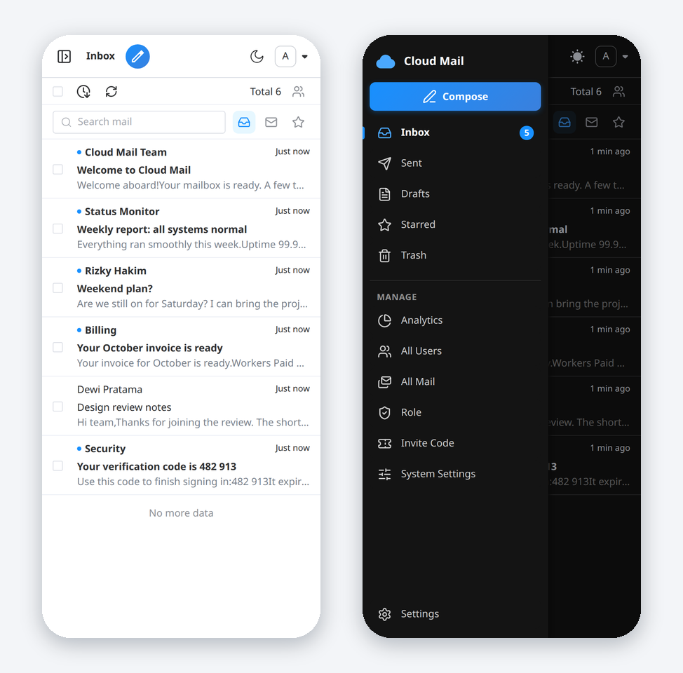

<p align="center">
  
</p>

<h1 align="center">Cloud Mail</h1>

<p align="center">
  A simple, fast, responsive email service that runs entirely on Cloudflare Workers.<br>
  One domain, as many mailboxes as you want, no server to maintain.
</p>

<p align="center">
  <a href="LICENSE"></a>
  
  
  
</p>

<p align="center">
  <a href="#features">Features</a> ·
  <a href="#deploy">Deploy</a> ·
  <a href="#after-you-deploy">After you deploy</a> ·
  <a href="#configuration-reference">Configuration</a> ·
  <a href="#open-api">Open API</a> ·
  <a href="#troubleshooting">Troubleshooting</a> ·
  <a href="#local-development">Development</a>
</p>

<p align="center">
  
</p>

---

## Contents

- [About](#about)
- [Screenshots](#screenshots)
- [Features](#features)
- [Deploy](#deploy)
  - [What you need](#what-you-need)
  - [Choose a method](#choose-a-method)
  - [Method A: GitHub Actions (recommended)](#method-a-github-actions-recommended)
  - [Method B: Cloudflare Git Integration](#method-b-cloudflare-git-integration)
  - [Method C: Manual deploy with Wrangler](#method-c-manual-deploy-with-wrangler)
- [After you deploy](#after-you-deploy)
  - [1. Receive mail](#1-receive-mail)
  - [2. Send mail](#2-send-mail)
  - [3. Initialize the database](#3-initialize-the-database)
  - [4. Sign in and lock things down](#4-sign-in-and-lock-things-down)
- [Optional features](#optional-features)
- [Configuration reference](#configuration-reference)
- [Using Cloud Mail](#using-cloud-mail)
- [Open API](#open-api)
- [Updating](#updating)
- [Troubleshooting](#troubleshooting)
- [Local development](#local-development)
- [Project structure](#project-structure)
- [Tech stack](#tech-stack)
- [Credits and changes](#credits-and-changes)
- [License](#license)

## About

Cloud Mail gives one domain many mailboxes, the way the big mail providers do. Incoming mail arrives through
Cloudflare Email Routing, everything is stored in Cloudflare D1, KV and (optionally) R2, and the web app, the API
and the mail handler are one Worker. There is nothing to host, patch or keep running.

It works for a personal domain, a small team, or as a catch-all inbox for projects and sign-ups.

## Screenshots

<table>
  <tr>
    <td width="50%"><br><sub><b>Dark theme.</b> One neutral surface everywhere, white or dark sidebar to match the theme.</sub></td>
    <td width="50%"><br><sub><b>Compose.</b> Sender picker, Cc and Bcc, drafts, and a full rich text editor.</sub></td>
  </tr>
  <tr>
    <td width="50%"><br><sub><b>System settings.</b> Every site-wide option has a help line and its current status.</sub></td>
    <td width="50%"><br><sub><b>Sign in.</b> Password manager friendly, with a theme switch.</sub></td>
  </tr>
  <tr>
    <td colspan="2" align="center"><br><sub><b>Mobile.</b> The sidebar becomes a drawer, every page works on a phone.</sub></td>
  </tr>
</table>

## Features

**Mail**
- Receive mail through Cloudflare Email Routing, send through Resend or Cloudflare Email Sending.
- Cc and Bcc, reply and forward, attachments, inline images, and drafts you can save with one click.
- Read in a list, with a resizable pane on the right, or with a pane at the bottom.
- Search, unread and starred filters, mark as unread, trash with restore, and keyboard shortcuts (press `?`).
- Block remote images so a sender cannot tell when you open a mail.
- New mail notifications with unread badges, desktop alerts and an optional sound.
- Forward incoming mail to Telegram or to an outside address, with rules.

**Accounts and domains**
- Several mailbox addresses per user, with a custom colour per domain, grouping, sorting and drag and drop order.
- Registration that is open, closed, or gated by invite codes, with optional Cloudflare Turnstile.

**Administration**
- Roles with fine grained permissions, send limits and allowed domains.
- User, mail and invite code management, and analytics with charts.
- Block rules by subject, content and sender, and limits on address prefixes.
- Verification code detection with Workers AI.

**Interface**
- Light and dark themes, a collapsible icon rail, English, Chinese (中文) and Bahasa Indonesia.
- Responsive from a phone to a wide monitor.

**For developers**
- A small [Open API](#open-api) for creating users and querying mail.
- Browser checks in [`e2e/`](e2e/README.md) for the main flows.

## Deploy

### What you need

| | |
|---|---|
| A Cloudflare account | The free plan is enough to start. |
| A domain on Cloudflare | Added to your account and using Cloudflare DNS. Email Routing needs this. |
| A GitHub account | For methods A and B. Method C needs only a terminal. |
| 10 to 15 minutes | Most of it is clicking through the Cloudflare dashboard. |

You will also choose three values before you start. Write them down.

| Value | Example | Notes |
|---|---|---|
| `DOMAIN` | `["example.com"]` | A JSON array. Every address will be `name@example.com`. |
| `ADMIN` | `admin@example.com` | The first administrator. It must end with one of your domains. |
| `JWT_SECRET` | `7c1e...` | Any long random string. Do not use `?`, `%`, `#`, `/` or `\`. Keep it private. |

A quick way to make a secret: `openssl rand -hex 32`.

### Choose a method

| Method | Best for | Effort |
|---|---|---|
| **A. GitHub Actions** | Most people. Creates D1 and KV for you, deploys, and initializes the database. | Lowest |
| **B. Cloudflare Git Integration** | You want Cloudflare to build the repo on every push. | Low |
| **C. Manual with Wrangler** | You prefer the command line, or want to see every step. | Medium |

Whichever you pick, continue with [After you deploy](#after-you-deploy) afterwards.

### Method A: GitHub Actions (recommended)

1. **Fork** this repository on GitHub.
2. **Create a Cloudflare API token.**
   Cloudflare dashboard, My Profile, API Tokens, Create Token. Start from the **Edit Cloudflare Workers**
   template, then add **D1: Edit**. Add **R2: Edit** as well if you want attachments in R2.
3. **Find your Account ID.** Dashboard, Workers & Pages, the right side of the overview page.
4. **Add secrets** in your fork: Settings, Secrets and variables, Actions.

   | Secret | Required | Description |
   |---|:---:|---|
   | `CLOUDFLARE_API_TOKEN` | yes | The token from step 2. |
   | `CLOUDFLARE_ACCOUNT_ID` | yes | The ID from step 3. |
   | `DOMAIN` | yes | JSON array, for example `["example.com"]`. |
   | `ADMIN` | yes | Admin email, for example `admin@example.com`. |
   | `JWT_SECRET` | yes | Your random secret. |
   | `CUSTOM_DOMAIN` | recommended | Where the app will live, for example `mail.example.com`. The domain must be in the same Cloudflare account. Without it the app is only on a `workers.dev` address. |
   | `D1_DATABASE_ID` | no | Leave empty and the workflow creates the database. |
   | `KV_NAMESPACE_ID` | no | Leave empty and the workflow creates the namespace. |
   | `R2_BUCKET_NAME` | no | Set it to store attachments in R2. Create the bucket first. |
   | `NAME` | no | Worker name. Default `cloud-mail`. |
   | `AI_MODEL` | no | Workers AI model. Default `@cf/meta/llama-3.1-8b-instruct`. |
   | `CF_EMAIL` | no | Set to `true` to send through Cloudflare Email Sending. |
   | `ANALYSIS_CACHE` | no | Set to `true` to cache analytics data. |
   | `PROJECT_LINK` | no | Shows the project link button on the sign-in page. |

   Secrets can also be added as repository **Variables**. Secrets win if both exist.
5. **Run the workflow.** Actions tab, *Deploy cloud-mail to Cloudflare Workers*, *Run workflow*. It also runs
   on every push to `main` that touches `mail-worker/` or `mail-vue/`.

The workflow builds the frontend, fills in `mail-worker/wrangler-action.toml`, creates the D1 database and KV
namespace if you did not provide IDs, deploys the Worker, waits briefly, and then **initializes the database for
you** by calling `/api/init/<JWT_SECRET>`. When the run is green you can skip
[Initialize the database](#3-initialize-the-database).

> If the last step fails, open `https://<your-domain>/api/init/<JWT_SECRET>` yourself. You should see `success`.

### Method B: Cloudflare Git Integration

Cloudflare builds and deploys the repository for you on every push, using the **root** `wrangler.toml`.

1. Create a D1 database and a KV namespace (Workers & Pages, D1 and KV). Optionally an R2 bucket.
2. In your fork, open the root `wrangler.toml` and put in your own IDs:

   ```toml
   [[d1_databases]]
   binding = "db"
   database_name = "cloud-mail"
   database_id = "<your-d1-database-id>"

   [[kv_namespaces]]
   binding = "kv"
   id = "<your-kv-namespace-id>"
   ```

   Uncomment the `r2_buckets` block for attachments, or `send_email` for Cloudflare Email Sending.
3. Dashboard, Workers & Pages, Create, **Import a repository**. Pick your fork. Leave the root directory at `/`.
   The build command comes from `wrangler.toml`.
4. After the first deploy, open the Worker, Settings, **Variables and Secrets**, and add:
   `domain` (text, for example `["example.com"]`), `admin` (text) and `jwt_secret` (secret).
5. Redeploy so the variables take effect, then continue with
   [Initialize the database](#3-initialize-the-database).

> **Keep the bindings in the file.** Every binding missing from the root `wrangler.toml` is **removed** from the
> Worker on the next deploy, even if you added it in the dashboard. Variables are kept (`keep_vars = true`),
> bindings are not. A missing binding shows up as errors like "KV database not bound". Before you push, you can
> preview what will be deployed with `wrangler deploy --dry-run --config wrangler.toml`.

### Method C: Manual deploy with Wrangler

<details>
<summary>Show the commands</summary>

Requirements: Node.js 22 and pnpm 9.

```bash
git clone https://github.com/imrosyd/cloud-mail.git
cd cloud-mail

# install both projects
pnpm --prefix mail-worker install
pnpm --prefix mail-vue install

# sign in to Cloudflare (opens a browser)
./mail-worker/node_modules/.bin/wrangler login

# create the resources and note the IDs they print
./mail-worker/node_modules/.bin/wrangler d1 create cloud-mail
./mail-worker/node_modules/.bin/wrangler kv namespace create cloud-mail
```

Edit the root `wrangler.toml`: paste the two IDs, and set your values under `[vars]`:

```toml
[vars]
domain = ["example.com"]
admin = "admin@example.com"
```

Store the secret, then build and deploy. The build command in `wrangler.toml` builds the frontend for you.

```bash
./mail-worker/node_modules/.bin/wrangler secret put jwt_secret --config wrangler.toml
./mail-worker/node_modules/.bin/wrangler deploy --config wrangler.toml
```

Continue with [Initialize the database](#3-initialize-the-database).

</details>

## After you deploy

### 1. Receive mail

Incoming mail needs **Cloudflare Email Routing**:

1. Cloudflare dashboard, pick your domain, **Email**, **Email Routing**.
2. Click **Get started** and let Cloudflare add its DNS records.
3. Under **Routing rules**, **Catch-all**, set the action to **Send to a Worker** and choose your Worker.
4. Save.

Cloudflare adds these records for you:

| Type | Name | Value |
|---|---|---|
| MX | `@` | `route1.mx.cloudflare.net`, `route2.mx.cloudflare.net`, `route3.mx.cloudflare.net` |
| TXT | `@` | `v=spf1 include:_spf.mx.cloudflare.net ~all` |

### 2. Send mail

Sending to other Cloud Mail addresses on your own domains works right away. To send to the outside world,
pick one provider:

**Resend (recommended)**
1. Sign up at [resend.com](https://resend.com), add and verify your domain, and create an API key.
2. In Cloud Mail, **System Settings**, **Email**, **Resend Token**, add the key for that domain.
3. Optional: add a Resend webhook to `https://<your-domain>/api/webhooks` so delivery status is recorded.

**Cloudflare Email Sending**
Turn it on with `CF_EMAIL=true` (GitHub Actions), or uncomment this in the root `wrangler.toml` and redeploy:

```toml
[[send_email]]
name = "email"
```

It needs Email Routing to be active on the same domain.

### 3. Initialize the database

Skip this if you used GitHub Actions and the run was green. Otherwise open this address once in a browser:

```
https://<your-domain>/api/init/<JWT_SECRET>
```

You should see `success`. It creates the tables and the default settings. It is safe to open again after an
update, which is how new database changes are applied.

### 4. Sign in and lock things down

1. Open your domain and **Sign up** with the address you set as `ADMIN`. That account becomes the administrator.
2. Open **System Settings** and review the defaults.

> **A fresh install starts with sign-up open.** If this is a private mailbox, switch **Sign Up** off in
> System Settings, Website, as soon as your admin account exists. If you want sign-ups, consider invite codes and
> Cloudflare Turnstile first (see [Optional features](#optional-features)).

Quick check that everything works:

- [ ] You can sign in as the admin.
- [ ] A mail sent from outside arrives in the inbox.
- [ ] A mail you send reaches another address.
- [ ] Sign Up is set the way you want it.

## Optional features

| Feature | How to turn it on |
|---|---|
| **Attachments** | R2: create a bucket, then set `R2_BUCKET_NAME` (Actions) or uncomment `r2_buckets` in `wrangler.toml`, and set the R2 public domain in System Settings. Or use any S3 compatible storage: enter bucket, region, endpoint and keys under System Settings, Object Storage, S3 Configuration. Without either, attachments are stored in KV. |
| **Verification code detection** | Needs the `ai` binding (already declared). Turn on **Workers AI**, Verification Code Recognition, in System Settings. |
| **Telegram push** | Create a bot with BotFather, then System Settings, Email Push, Telegram Bot, and add the token and chat ID. |
| **Forward to an outside address** | System Settings, Email Push, Forwarding to External Email. |
| **Turnstile** | Create a Turnstile widget in Cloudflare, add the Site Key and Secret Key in System Settings, then enable Sign Up Verification or Add Email Verification. |
| **Invite codes** | System Settings, Website, Invite Code, then create codes under the Invite Code page. |
| **Custom branding** | System Settings, Customization: title, sign-in background, box opacity and dimming. |
| **Announcement** | System Settings, Notice, Sign-In Popup. |

## Configuration reference

### Environment variables

| Variable | Default | Description |
|---|---|---|
| `domain` | none | JSON array of mail domains, for example `["example.com"]`. |
| `admin` | none | Administrator email. |
| `jwt_secret` | none | Signing secret for sessions. Also used in the init URL. Store it as a secret. |
| `ai_model` | `@cf/meta/llama-3.1-8b-instruct` | Workers AI model for code detection. |
| `analysis_cache` | `false` | Cache analytics data. |

### Bindings

| Binding | Name | Required | Used for |
|---|---|:---:|---|
| D1 database | `db` | yes | Main database. |
| KV namespace | `kv` | yes | Cache, sessions, small attachments. |
| Assets | `assets` | yes | The built frontend (`mail-worker/dist`). |
| R2 bucket | `r2` | no | Attachments. |
| Workers AI | `ai` | no | Verification code detection. |
| Email Sending | `email` | no | Sending through Cloudflare. |

### Scheduled jobs

| Cron (UTC) | What it does |
|---|---|
| `*/30 * * * *` | Refresh the analytics cache. |
| `0 16 * * *` | Clear expired verification records, reset daily send counts, finish pending receives, remove unbound OAuth users, refresh analytics. |

### Which config file is used for what

| File | Used for |
|---|---|
| `wrangler.toml` (repo root) | Cloudflare Git Integration and manual deploys. Declare every binding here. |
| `mail-worker/wrangler-action.toml` | Template the GitHub Actions workflow fills in. |
| `mail-worker/wrangler.toml` | `pnpm start` and `pnpm deploy` from `mail-worker`. |
| `mail-worker/wrangler-dev.toml` | Local development (`pnpm dev`). |
| `mail-worker/wrangler-test.toml` | A throwaway test Worker (`pnpm test`). |

### System Settings

<details>
<summary>What every setting does</summary>

| Card | Setting | What it does |
|---|---|---|
| Website | Sign Up | Let visitors create an account. |
| | Hide Sign-In Domain | Hide the `@domain` list on the sign-in page. Users type the full address. |
| | Invite Code | Ask for an invite code when signing up. |
| | Add Email Address | Let users add mailbox addresses themselves. |
| | Multiple Email Address | Allow more than one address per user. |
| | Email Prefix | Minimum name length and forbidden prefixes for new addresses. |
| Customization | Title, Login Box Opacity, Background Dim, Background | Site name and the look of the sign-in page. |
| Notice | Sign-In Popup, Pop Up | An announcement window on the sign-in page, and a preview button. |
| Workers AI | Verification Code Recognition, Recognition Rules | Find codes in incoming mail. Rules limit it to mail that contains given text. |
| Email | Receive Email, Send Email | Turn receiving or sending on or off. Turning them off asks first. |
| | Auto Refresh | How often the inbox checks for new mail. |
| | No Recipient | Accept mail for addresses that do not exist yet. |
| | Resend Token | API key per domain for sending outside. |
| | Blocklist | Reject mail by subject, content or sender. |
| Email Push | Telegram Bot, Forwarding to External Email, Forwarding Rules | Push or forward incoming mail. |
| Object Storage | Domain, S3 Configuration, Storage Location | Where attachments live. Storage Location only shows the current choice. |
| Turnstile | Sign Up Verification, Add Email Verification, Site Key, Secret Key | Bot checks. They cannot be enabled until both keys are set. |

The page has a search box. Changes save as soon as you make them.

</details>

## Using Cloud Mail

**For everyone**
- The sidebar holds Inbox, Sent, Drafts, Starred, Trash and Settings. Collapse it into an icon rail with the
  button at the bottom.
- The account panel lists your mailboxes. Pick one, or turn on "receive all" to see everything in one inbox.
- The toolbar switches the reading layout. Press `?` to see the keyboard shortcuts.
- Settings has your name, password, language, notifications, and remote image blocking.

**For administrators** (the Manage section appears only for roles that have permission)

| Page | Purpose |
|---|---|
| Analytics | Charts for users and mail volume. |
| All Users | Search, add, ban, delete and restore users, and change roles and limits. |
| All Mail | Browse mail across all users. |
| Role | Create roles with permissions, send limits and allowed domains. |
| Invite Code | Create, list and clear invite codes. |
| System Settings | Site-wide options, see above. |

## Open API

For scripts: create users in bulk and query mail. All paths are under `/api`.

<details>
<summary>Show the endpoints</summary>

**1. Get a token** with the admin email and password. Making a new token replaces the old one.

```bash
curl -X POST https://<your-domain>/api/public/genToken \
  -H 'Content-Type: application/json' \
  -d '{"email":"admin@example.com","password":"your-password"}'
# {"code":200,"message":"success","data":{"token":"..."}}
```

**2. Send the token** in the `Authorization` header on the other calls.

**Query mail:** `POST /api/public/emailList`

```bash
curl -X POST https://<your-domain>/api/public/emailList \
  -H 'Authorization: <token>' -H 'Content-Type: application/json' \
  -d '{"toEmail":"user@example.com","subject":"%code%","type":0,"num":1,"size":20}'
```

| Field | Description |
|---|---|
| `toEmail`, `sendEmail`, `sendName`, `subject`, `content` | Case-insensitive match. `%` is a wildcard. |
| `type` | `0` received, `1` sent. |
| `isDel` | Filter by deleted state. |
| `timeSort` | `asc` for oldest first, otherwise newest first. |
| `num`, `size` | Page number from 1, and page size (default 20). |

**Create users:** `POST /api/public/addUser`

```bash
curl -X POST https://<your-domain>/api/public/addUser \
  -H 'Authorization: <token>' -H 'Content-Type: application/json' \
  -d '{"list":[{"email":"a@example.com","password":"secret123","roleName":"user"},{"email":"b@example.com"}]}'
```

Each `email` must be on one of your domains. A random password is generated if you leave it out. `roleName` is
optional and must match an existing role. If an address already exists, the call fails.

</details>

## Updating

1. Merge the new version into your fork and push to `main`, or run the workflow again.
2. When the deploy finishes, open `https://<your-domain>/api/init/<JWT_SECRET>` once. This applies database changes.
3. Hard reload the browser (Ctrl+Shift+R) so it does not keep old files.

D1 is not backed up by this project. Export it now and then:

```bash
wrangler d1 export <database-name> --remote --output backup.sql
```

If an update misbehaves, `wrangler rollback <version-id>` returns the Worker to an earlier version. Note that a
later push deploys the latest code again, so revert the change in git as well.

## Troubleshooting

| Problem | Likely cause and fix |
|---|---|
| Errors like "KV database not bound", or the app stops after a push | A binding is missing from the root `wrangler.toml`, so the deploy removed it. Declare `db`, `kv`, and any `r2`, `ai`, `email` you use, then redeploy. |
| The init address says "JWT secret mismatch" | The value in the address must equal the `jwt_secret` the Worker uses. |
| The GitHub Action stops at "Set up environment" | `DOMAIN` must be a JSON array such as `["example.com"]`, and `JWT_SECRET` cannot contain `? % # / \`. |
| No mail arrives | Check that the catch-all rule sends to the Worker, that the MX records exist, that the domain is in `DOMAIN`, and that Receive Email is on. |
| Mail to outside addresses fails with "sending service is not configured" | Add a Resend token for that domain, or enable Cloudflare Email Sending. |
| "Only internal mailboxes" when sending | The user's role is limited. Change the role's send type under Role. |
| People can sign up and you did not want that | Switch Sign Up off in System Settings. A fresh install starts open. |
| Turnstile cannot be enabled | Add the Site Key and Secret Key first. |
| Attachments do not upload | Set up R2 or S3 in System Settings, or check the `r2` binding. |
| The page looks old after an update | Hard reload (Ctrl+Shift+R). |

## Local development

Requirements: Node.js 22 and pnpm 9.

```bash
# backend: Worker with local D1 and KV, on port 8787
cd mail-worker
pnpm install
pnpm dev

# frontend: Vite on port 3001, talks to http://127.0.0.1:8787/api
cd mail-vue
pnpm install
pnpm dev
```

On a fresh local database, open `http://127.0.0.1:8787/api/init/<jwt_secret>` once. Local values live in the
`[vars]` block of `mail-worker/wrangler-dev.toml`. For secrets you do not want in a file, create a `.dev.vars`
file next to it (it is git-ignored).

| Command | Where | Does |
|---|---|---|
| `pnpm dev` | `mail-worker` | Run the Worker locally with `wrangler-dev.toml`. |
| `pnpm start` | `mail-worker` | Run the Worker locally with `wrangler.toml`. |
| `pnpm deploy` | `mail-worker` | Deploy with `wrangler.toml`. |
| `pnpm dev` | `mail-vue` | Vite dev server. |
| `pnpm remote` | `mail-vue` | Vite dev server against a remote API (`.env.remote`). |
| `pnpm build` | `mail-vue` | Build into `mail-worker/dist`. |

To serve the built frontend from the local Worker, run `pnpm build` in `mail-vue` and restart the Worker.
`wrangler dev` caches the asset list, so without a restart new pages can be blank.

**Browser checks.** `e2e/` has checks for sign-in, search, delete and undo, trash, the reading pane, compose and
the admin pages. They only run against a local instance. See [`e2e/README.md`](e2e/README.md).

```bash
# Playwright is not a dependency of this repo; point PLAYWRIGHT_PATH at an installed copy
PLAYWRIGHT_PATH=/path/to/node_modules/playwright E2E_BASE=http://localhost:8787 node e2e/run.mjs
```

The run first resets the passwords of the `qa` and `admin` test users in the local database and adds a few awkward
test mails, so never point it at real data.

Frontend modes (`mail-vue/.env.*`):

| Mode | API base | Output |
|---|---|---|
| `dev` | `http://127.0.0.1:8787/api` | Vite dev server |
| `release` | `/api` | `mail-worker/dist` |
| `remote` | a remote server (edit before use) | Vite dev server |

## Project structure

```
cloud-mail
├── wrangler.toml               Root config for Cloudflare Git Integration and manual deploys
├── .github/workflows           GitHub Actions deploy workflow
├── doc/demo                    Logo and screenshots
├── e2e                         Browser checks for a local instance
│
├── mail-worker                 Backend Worker
│   ├── src
│   │   ├── api                 Routes
│   │   ├── const               Constants
│   │   ├── dao                 Data access
│   │   ├── email               Incoming mail handler
│   │   ├── entity              Database tables
│   │   ├── error               Custom errors
│   │   ├── hono                Web framework, middleware
│   │   ├── i18n                en, zh, id
│   │   ├── init                Database setup and migrations
│   │   ├── model               Response models
│   │   ├── security            Authentication and permissions
│   │   ├── service             Business logic
│   │   ├── template            Message templates
│   │   ├── utils               Helpers
│   │   └── index.js            Entry (fetch, email and scheduled handlers)
│   └── wrangler-*.toml         Deploy, dev and test configs
│
└── mail-vue                    Frontend (Vue 3)
    ├── public                  Favicon, icons, editor files
    └── src
        ├── components          Shared components
        ├── composables         Reusable logic (theme, shortcuts, notifier, ...)
        ├── i18n                en, zh, id
        ├── layout              Sidebar, header, compose window
        ├── perm                Permissions
        ├── request             API calls
        ├── router              Routes
        ├── store               State
        └── views               Pages
```

## Tech stack

- Platform: [Cloudflare Workers](https://developers.cloudflare.com/workers/), D1, KV, R2, Workers AI, Email Routing
- Backend: [Hono](https://hono.dev/), [Drizzle ORM](https://orm.drizzle.team/)
- Frontend: [Vue 3](https://vuejs.org/), [Element Plus](https://element-plus.org/), [Vite](https://vitejs.dev/), [TinyMCE](https://www.tiny.cloud/), [ECharts](https://echarts.apache.org/)
- Sending: [Resend](https://resend.com/) or Cloudflare Email Sending

## Credits and changes

Cloud Mail is developed from [maillab/cloud-mail](https://github.com/maillab/cloud-mail). Thank you to its authors for
the foundation: the Worker, the mail handling, the data model and the first version of the interface. Their own
documentation is at [doc.skymail.ink](https://doc.skymail.ink).

This fork keeps that base and adds, among other things:

- A redesigned interface: collapsible icon rail sidebar, white sidebar in the light theme, a neutral dark theme,
  redesigned sign-in, settings and system settings pages, and a new logo.
- Reading pane layouts (right or bottom), a trash with restore, mark as unread, remote image blocking and keyboard
  shortcuts.
- Compose: sender picker, Cc and Bcc, a save draft button, and a richer editor.
- New mail notifications with unread badges, desktop alerts and sound.
- Account list improvements: colour per domain, grouping, sorting and drag and drop order.
- Paging with 5, 10, 20 or 50 rows, and Bahasa Indonesia.
- A root `wrangler.toml` for Cloudflare Git Integration, and browser checks in `e2e/`.

## License

[MIT](LICENSE). The original copyright notice is kept as the license requires.
