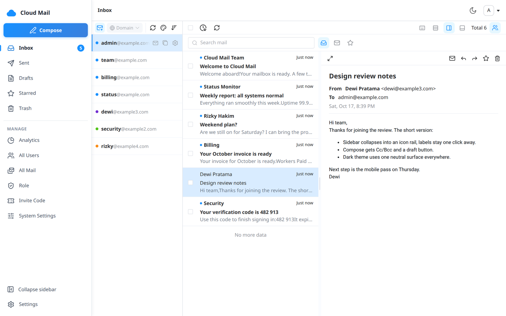
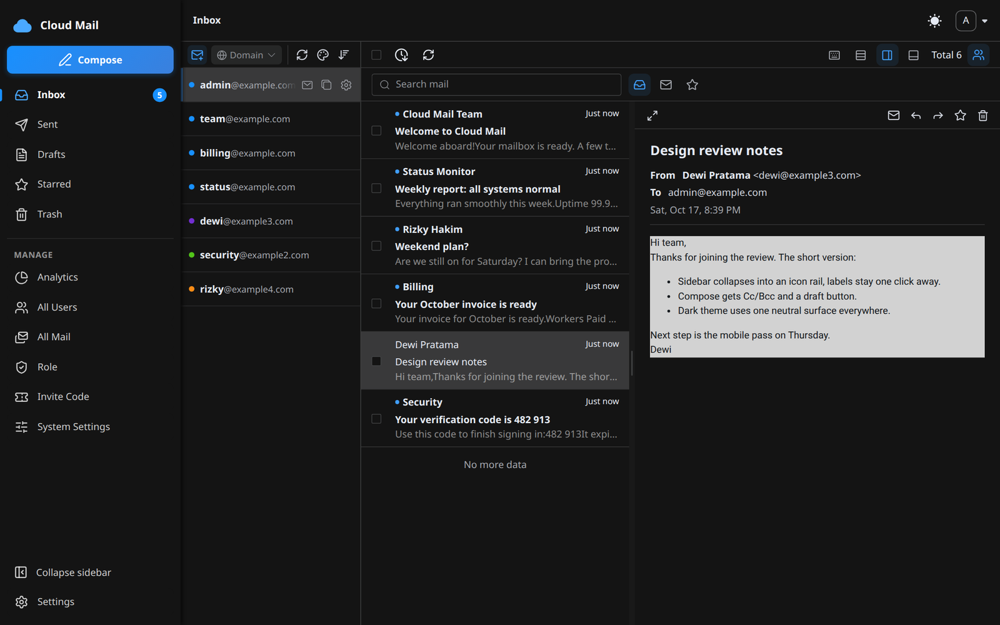
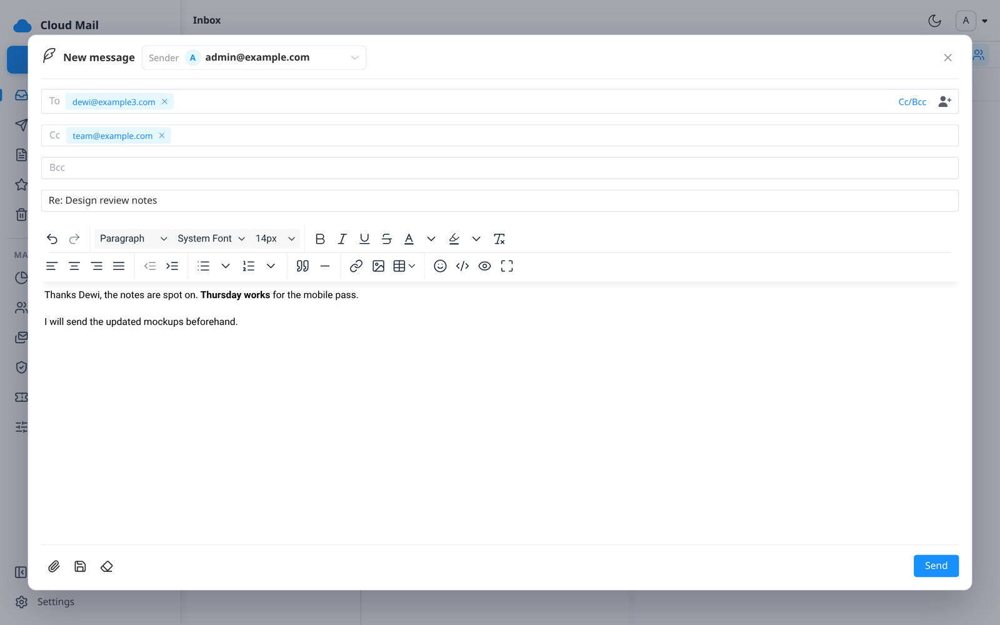
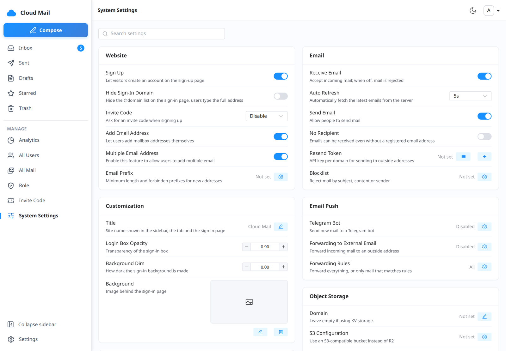

<p align="center">
    
    <h1 align="center">Cloud Mail</h1>
    <p align="center">A simple, responsive email service designed to run on Cloudflare Workers 🎉</p>
</p>

## Contents

- [Description](#description)
- [Screenshots](#screenshots)
- [Features](#features)
- [Installation](#installation)
- [Updating](#updating)
- [Local Development](#local-development)
- [Using the App](#using-the-app)
- [Open API](#open-api)
- [Configuration Reference](#configuration-reference)
- [Scheduled Jobs](#scheduled-jobs)
- [Tech Stack](#tech-stack)
- [Project Structure](#project-structure)
- [License](#license)

## Description

With only one domain, you can create multiple different email addresses, similar to major email platforms. This project deploys entirely on Cloudflare Workers, so no server is required.

One Worker does everything: it serves the Vue frontend as static assets, answers the API under `/api`, and handles incoming mail from Cloudflare Email Routing.

## Screenshots

<p align="center">
    
    
    
    
</p>

## Features

- **💰 Low-Cost**: No server required. Runs entirely on Cloudflare's free tier.
- **💻 Responsive Design**: Adapts to desktop and mobile browsers.
- **📧 Email Sending**: Send emails via Resend API or Cloudflare Email Sending, with attachment support.
- **📥 Email Receiving**: Receive emails via Cloudflare Email Routing.
- **🗂️ Reading Layouts**: Switch between a list, a list with a reading pane on the right, or a pane at the bottom. The pane can be resized.
- **🔎 Search and Filters**: Search mail and filter by read state and starred, with star, unread, delete, restore and empty-trash actions.
- **🔔 Notifications**: Optional desktop notifications and a notification sound for new mail.
- **🖼️ Privacy**: Block remote images so senders cannot tell when you open a mail.
- **🛡️ Admin Panel**: User, role and email management with RBAC-based access control.
- **🎟️ Invite Codes**: Registration can be open, closed, or gated by invite codes (reg keys).
- **🔐 Sign-in Options**: Email and password, plus Linux.do OAuth when configured.
- **📦 Attachment Support**: Send and receive attachments stored in R2 object storage or an S3-compatible bucket.
- **📤 Email Push**: Forward received emails to Telegram bots or external email addresses.
- **🚫 Filtering Rules**: Block mail by sender, subject or content, and restrict allowed address prefixes.
- **📡 Open API**: Batch user creation and multi-condition email queries over HTTP (see [Open API](#open-api)).
- **🔢 Verification Code Recognition**: Auto-detect codes via Workers AI.
- **📈 Analytics**: Visualize system data with ECharts.
- **🎨 Personalization**: Customize title, login background, transparency, and a site notice.
- **🤖 CAPTCHA**: Cloudflare Turnstile integration.
- **🌐 Multilingual**: English, 中文, Bahasa Indonesia.

## Installation

### Prerequisites

- Cloudflare account with a domain added and proxied through Cloudflare
- Fork of [github.com/imrosyd/cloud-mail](https://github.com/imrosyd/cloud-mail)

There are two ways to deploy. **Option 1 (GitHub Actions)** is the recommended path for a fork. **Option 2 (Cloudflare Git Integration)** lets Cloudflare build the repo itself on every push.

---

### Step 1: Create Cloudflare Resources

Create the following in your Cloudflare Dashboard before deploying:

**D1 Database**: Workers & Pages → D1 → Create database (name: `cloud-mail`)

**KV Namespace**: Workers & Pages → KV → Create namespace (name: `cloud-mail`)

**R2 Bucket** *(optional, for attachments)*: R2 → Create bucket

---

### Step 2: Deploy

#### Option 1: GitHub Actions

Add the following **Secrets** (or repository **Variables**) in your forked repo → Settings → Secrets and variables → Actions:

| Secret | Required | Description |
|--------|----------|-------------|
| `CLOUDFLARE_API_TOKEN` | ✅ | Cloudflare API token with Workers, D1, KV, R2 permissions |
| `CLOUDFLARE_ACCOUNT_ID` | ✅ | Your Cloudflare account ID |
| `DOMAIN` | ✅ | JSON array of domains, e.g. `["example.com"]` |
| `ADMIN` | ✅ | Admin email, e.g. `admin@example.com` |
| `JWT_SECRET` | ✅ | Any random string (avoid `?`, `%`, `#`, `/`, `\`) |
| `D1_DATABASE_ID` | ✅ | D1 database ID from Step 1 |
| `KV_NAMESPACE_ID` | ✅ | KV namespace ID from Step 1 |
| `R2_BUCKET_NAME` | ➖ | R2 bucket name (required for attachments) |
| `CUSTOM_DOMAIN` | ➖ | Custom domain for your worker, e.g. `mail.example.com` |
| `NAME` | ➖ | Worker name (default: `cloud-mail`) |
| `AI_MODEL` | ➖ | Workers AI model (default: `@cf/meta/llama-3.1-8b-instruct`) |
| `CF_EMAIL` | ➖ | Set to `true` to enable the Cloudflare Email Sending binding |
| `ANALYSIS_CACHE` | ➖ | Set to `true` to cache analytics data |
| `LINUXDO_CLIENT_ID`, `LINUXDO_CLIENT_SECRET`, `LINUXDO_CALLBACK_URL`, `LINUXDO_SWITCH` | ➖ | Linux.do OAuth sign-in |

Push to `main` (changes under `mail-worker/` or `mail-vue/`) or run the workflow manually to deploy. The workflow builds the frontend, fills `mail-worker/wrangler-action.toml` from the values above, and automatically creates D1/KV resources if IDs are not provided.

#### Option 2: Cloudflare Git Integration

Connect the repository to a Worker in the Cloudflare Dashboard. Cloudflare builds and deploys the **root** `wrangler.toml` on every push, using its `[build]` command (installs both projects and builds the frontend into `mail-worker/dist`).

Before the first deploy, edit the root `wrangler.toml`:

- Set the real IDs of your D1 database and KV namespace.
- Set `domain`, `admin` and `jwt_secret` as Worker variables (dashboard → Settings → Variables), or in `[vars]`.
- Uncomment the `r2_buckets` or `send_email` blocks if you use them.

> **Important:** every binding that is missing from the root `wrangler.toml` is **removed** from the deployed Worker on the next push (`keep_vars = true` only preserves plain variables). If you add a binding in the dashboard, also add it to the file, or the next deploy drops it and the app fails with errors such as "KV database not bound". Before pushing, check what will be deployed with `wrangler deploy --dry-run --config wrangler.toml`.

---

### Step 3: Set Up Email Routing (Receiving)

To receive emails, configure **Cloudflare Email Routing**:

1. Go to **Cloudflare Dashboard** → select your domain → **Email** → **Email Routing**
2. Click **Get started** and let Cloudflare add the required DNS records automatically
3. Under **Routing rules** → **Catch-all** → set action to **Send to a Worker** → select your worker
4. Save

Cloudflare will add the following DNS records to your domain:

| Type | Name | Value |
|------|------|-------|
| MX | `@` | `route1.mx.cloudflare.net` |
| MX | `@` | `route2.mx.cloudflare.net` |
| MX | `@` | `route3.mx.cloudflare.net` |
| TXT | `@` | `v=spf1 include:_spf.mx.cloudflare.net ~all` |

---

### Step 4: Set Up Email Sending

Choose one of the following methods:

#### Option A: Resend API (Recommended)

1. Sign up at [resend.com](https://resend.com) and create an API key
2. Verify your domain in Resend
3. In Cloud Mail → **System Settings** → **Email** → **Resend Token** → enter your API key
4. *(Optional)* Add a Resend webhook pointing to `https://<your-worker-domain>/api/webhooks` so delivery status is recorded

#### Option B: Cloudflare Email Sending

Enable the binding: set `CF_EMAIL=true` for GitHub Actions, or uncomment the following in the root `wrangler.toml`:

```toml
[[send_email]]
name = "email"
```

Then redeploy. Cloudflare Email Sending requires Email Routing to be active on the same domain.

---

### Step 5: Initialize Database

After deployment, open the following URL in your browser:

```
https://<your-worker-domain>/api/init/<jwt_secret>
```

You should see `success`. This creates all database tables and initializes the cache. It is safe to run again after an update (see [Updating](#updating)).

---

### Step 6: Sign In

Visit your worker domain, register using the admin email configured in `ADMIN`, and start using Cloud Mail.

---

### Optional: Attachments

Attachments need object storage. Choose one:

- **R2**: create a bucket, bind it as `r2` (`R2_BUCKET_NAME` in GitHub Actions, or the `r2_buckets` block in `wrangler.toml`), then set the R2 public domain in **System Settings**.
- **S3-compatible storage**: enter the bucket, region, endpoint, access key and secret key in **System Settings**. Path-style addressing can be toggled there.

## Updating

1. Pull or merge the new version into your fork and push to `main` (or trigger the workflow).
2. After the deploy finishes, open `https://<your-worker-domain>/api/init/<jwt_secret>` once. It applies pending database changes.
3. Hard-reload the browser (Ctrl+Shift+R) so it does not keep serving cached assets.

D1 is not backed up by this project. Export it periodically with `wrangler d1 export <database-name> --remote --output backup.sql`.

## Local Development

Requirements: Node.js 22 and pnpm 9.

```bash
# backend: Worker + local D1/KV (wrangler-dev.toml), listens on 0.0.0.0:8787
cd mail-worker
pnpm install
pnpm dev

# frontend: Vite dev server on port 3001, talks to http://127.0.0.1:8787/api
cd mail-vue
pnpm install
pnpm dev
```

On a fresh local database, open `http://127.0.0.1:8787/api/init/<jwt_secret>` once. Set `domain`, `admin` and `jwt_secret` in the `[vars]` of `mail-worker/wrangler-dev.toml` (or a `.dev.vars` file).

| Command | Where | What it does |
|---------|-------|--------------|
| `pnpm dev` | `mail-worker` | Run the Worker locally with `wrangler-dev.toml` |
| `pnpm start` | `mail-worker` | Run the Worker locally with `wrangler.toml` |
| `pnpm deploy` | `mail-worker` | Deploy with `wrangler.toml` |
| `pnpm dev` | `mail-vue` | Vite dev server (mode `dev`) |
| `pnpm remote` | `mail-vue` | Vite dev server against a remote API (`.env.remote`) |
| `pnpm build` | `mail-vue` | Production build into `mail-worker/dist` (mode `release`) |

To serve the built frontend from the local Worker, run `pnpm build` in `mail-vue`, then restart the Worker. `wrangler dev` caches the asset manifest, so without a restart new pages can 404 or render blank.

### UI Checks

`e2e/` contains browser checks for the main flows (login, search, delete and undo, trash, reading pane, admin pages). They only run against the local dev instance. See [`e2e/README.md`](e2e/README.md).

```bash
node e2e/run.mjs
```

The files `mail-worker/wrangler-test.toml` and `pnpm test` in `mail-worker` deploy a separate throwaway test Worker. They are not a unit-test runner.

## Using the App

### Mailboxes and accounts

Each user can own several mailbox addresses on your domains (limits are set per role). The left column lists your mailboxes, with unread badges. The sidebar has Inbox, Sent, Drafts, Starred, Trash and Settings. Deleted mail goes to Trash and can be restored or purged.

### Settings (per user)

Username, password, language, desktop notifications and sound, remote-image blocking, and account deletion (when the role allows it).

### Admin pages

Shown only to roles that have the matching permission.

| Page | Purpose |
|------|---------|
| All Users | Search, filter, add, ban, delete and restore users; change role and limits |
| Permissions | Create roles and choose their permissions, send and mailbox limits |
| System Settings | Registration, CAPTCHA, sending, Telegram and forwarding, filtering rules, storage, personalization |
| Invite Code | Create, list and clear registration keys and view their usage history |
| All Mail | Browse mail across all users |
| Analytics | Charts for users, mail volume and trends |

### Registration modes

In System Settings you can close registration, open it, and require, make optional, or disable invite codes. Cloudflare Turnstile can protect registration and adding mailboxes (set the site key and secret key).

## Open API

The Open API is for the admin to create users in bulk and to query mail from scripts. All paths are under `/api`.

**1. Get a token** with the admin email and password. Generating a new token replaces the previous one.

```bash
curl -X POST https://<your-worker-domain>/api/public/genToken \
  -H 'Content-Type: application/json' \
  -d '{"email":"admin@example.com","password":"your-password"}'
# {"code":200,"message":"success","data":{"token":"..."}}
```

**2. Send the token** in the `Authorization` header on the other calls.

**Query mail**: `POST /api/public/emailList`

```bash
curl -X POST https://<your-worker-domain>/api/public/emailList \
  -H 'Authorization: <token>' -H 'Content-Type: application/json' \
  -d '{"toEmail":"user@example.com","subject":"%code%","type":0,"num":1,"size":20}'
```

| Field | Description |
|-------|-------------|
| `toEmail`, `sendEmail`, `sendName`, `subject`, `content` | Case-insensitive match; `%` works as a wildcard |
| `type` | `0` received, `1` sent |
| `isDel` | Filter by deleted state |
| `timeSort` | `asc` for oldest first, otherwise newest first |
| `num`, `size` | Page number (from 1) and page size (default 20) |

**Create users**: `POST /api/public/addUser`

```bash
curl -X POST https://<your-worker-domain>/api/public/addUser \
  -H 'Authorization: <token>' -H 'Content-Type: application/json' \
  -d '{"list":[{"email":"a@example.com","password":"secret123","roleName":"user"},{"email":"b@example.com"}]}'
```

Each `email` must belong to one of your configured domains. If `password` is omitted a random one is generated. `roleName` is optional and must match an existing role. An address that already exists makes the call fail.

## Configuration Reference

### Environment Variables

| Variable | Default | Description |
|----------|---------|-------------|
| `domain` | none | JSON array of email domains, e.g. `["example.com"]` |
| `admin` | none | Admin email address |
| `jwt_secret` | none | JWT signing secret |
| `ai_model` | `@cf/meta/llama-3.1-8b-instruct` | Workers AI model for code recognition |
| `analysis_cache` | `false` | Enable analytics data caching |

### Bindings

| Binding | Variable | Required | Description |
|---------|----------|----------|-------------|
| D1 Database | `db` | ✅ | Main database |
| KV Namespace | `kv` | ✅ | Cache and session storage |
| R2 Bucket | `r2` | ➖ | Attachment storage |
| Workers AI | `ai` | ➖ | Verification code recognition |
| Email Sending | `email` | ➖ | Cloudflare Email Sending |
| Assets | `assets` | ✅ | The built frontend (`mail-worker/dist`) |

### Wrangler Config Files

| File | Used for |
|------|----------|
| `wrangler.toml` (repo root) | Cloudflare Git Integration deploys. Declare every binding here |
| `mail-worker/wrangler-action.toml` | Template filled in by the GitHub Actions workflow |
| `mail-worker/wrangler.toml` | Manual `wrangler deploy` and `pnpm start` from `mail-worker` |
| `mail-worker/wrangler-dev.toml` | Local development (`pnpm dev`) |
| `mail-worker/wrangler-test.toml` | Throwaway test Worker (`pnpm test`) |

### Frontend Modes (`mail-vue/.env.*`)

| Mode | API base | Build output |
|------|----------|--------------|
| `dev` | `http://127.0.0.1:8787/api` | Vite dev server |
| `release` | `/api` | `mail-worker/dist` |
| `remote` | a remote server's `/api` (edit before use) | Vite dev server |

## Scheduled Jobs

The Worker runs two cron triggers (`wrangler.toml` `[triggers]`):

| Cron (UTC) | Does |
|------------|------|
| `*/30 * * * *` | Refresh the analytics cache |
| `0 16 * * *` | Clear expired verification records, reset daily send counts, finish pending receives, remove unbound OAuth users, refresh analytics |

## Tech Stack

- **Platform**: [Cloudflare Workers](https://developers.cloudflare.com/workers/)
- **Web Framework**: [Hono](https://hono.dev/)
- **ORM**: [Drizzle](https://orm.drizzle.team/)
- **Frontend**: [Vue 3](https://vuejs.org/) + [Element Plus](https://element-plus.org/) + [Vite](https://vitejs.dev/)
- **Email Sending**: [Resend](https://resend.com/) / Cloudflare Email Sending
- **Email Receiving**: [Cloudflare Email Routing](https://developers.cloudflare.com/email-routing/)
- **Cache**: [Cloudflare KV](https://developers.cloudflare.com/kv/)
- **Database**: [Cloudflare D1](https://developers.cloudflare.com/d1/)
- **File Storage**: [Cloudflare R2](https://developers.cloudflare.com/r2/) or S3-compatible storage
- **AI**: [Workers AI](https://developers.cloudflare.com/workers-ai/)

## Project Structure

```
cloud-mail
├── wrangler.toml               # Root config used by Cloudflare Git Integration
├── .github/workflows           # GitHub Actions deploy workflow
├── doc/demo                    # Logo and screenshots
├── e2e                         # Browser checks for the local dev instance
│
├── mail-worker                 # Backend worker project
│   ├── src
│   │   ├── api                 # API layer (routes)
│   │   ├── const               # Project constants
│   │   ├── dao                 # Data access layer
│   │   ├── email               # Email receiving handler
│   │   ├── entity              # Database entities
│   │   ├── error               # Custom exceptions
│   │   ├── hono                # Web framework, middleware, error handling
│   │   ├── i18n                # Internationalization (en, zh, id)
│   │   ├── init                # Database and cache initialization
│   │   ├── model               # Response data models
│   │   ├── security            # Authentication and authorization
│   │   ├── service             # Business logic layer
│   │   ├── template            # Message templates
│   │   ├── utils               # Utility functions
│   │   └── index.js            # Entry point (fetch, email and scheduled handlers)
│   ├── wrangler.toml           # Manual deployment config
│   ├── wrangler-action.toml    # GitHub Actions deployment template
│   ├── wrangler-dev.toml       # Local development config
│   └── wrangler-test.toml      # Test Worker config
│
└── mail-vue                    # Frontend Vue project
    ├── src
    │   ├── axios               # Axios configuration
    │   ├── components          # Shared components
    │   ├── composables         # Reusable composition functions
    │   ├── echarts             # ECharts integration
    │   ├── i18n                # Internationalization (en, zh, id)
    │   ├── init                # App startup initialization
    │   ├── layout              # Main layout components
    │   ├── perm                # Permissions and access control
    │   ├── request             # API request layer
    │   ├── router              # Router configuration
    │   ├── store               # Global state management
    │   ├── utils               # Utility functions
    │   └── views               # Page components
    ├── .env.dev / .env.release / .env.remote
    └── package.json
```

## License

This project is licensed under the [MIT](LICENSE) license.
